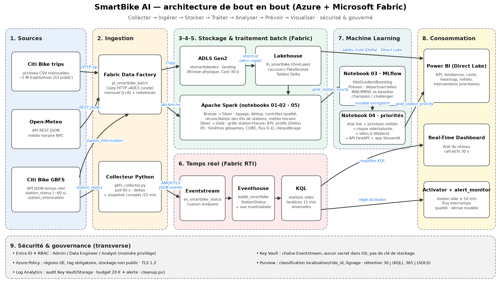

# SmartBike AI 🚲

**Anticiper le manque de vélos et de places dans les stations de vélos partagés** — projet du cours
*Design of Cloud Data-Driven Applications* (CDDA 2026-2027, Pr. Ibrahim RAHHAL).

Plateforme cloud de bout en bout sur **Microsoft Azure + Microsoft Fabric** à partir de données publiques réelles de
**Citi Bike New York**, enrichies par la météo : *Collecter → Ingérer → Stocker → Traiter → Analyser → Prévoir → Visualiser*,
sécurisée et gouvernée.



| Public | Décision rendue possible |
|---|---|
| Usager | voir l'état actuel des stations et choisir une alternative |
| Exploitant | savoir quelles stations vont être vides/saturées dans les 2 h et combien de vélos déplacer |
| Analyste mobilité | étudier la demande par lieu, heure, jour et météo |

## Couverture du cahier des charges

| Exigence minimale | Réalisation | Où |
|---|---|---|
| ≥ 2 sources hétérogènes | **3** : archives CSV Citi Bike, API JSON GBFS (live), API REST Open-Meteo | `scripts/01-03`, `gbfs_collector.py` |
| 1 pipeline batch | `pl_smartbike_batch` : Copy HTTP→ADLS (unzip) + notebooks, mensuel, paramètre `month` | `pipeline/` |
| Lakehouse raw/curated | ADLS `landing` → raccourci `Files/bronze` · tables `silver_*` · `gold_*` (médaillon) | `notebooks/01-02` |
| Notebook Spark → Delta | nettoyage, dédup, contrôles qualité, réconciliation des IDs, jointure météo, agrégats | `notebooks/01-02` |
| Streaming Eventstream → Eventhouse | collecteur GBFS 60 s → custom endpoint → `StationStatus` | `scripts/gbfs_collector.py`, `kql/01` |
| ≥ 2 KQL dont fenêtre temporelle | **7** requêtes (état actuel, fenêtres 15 min, vitesse de vidage, anomalies, moyenne glissante, qualité) | `kql/02_queries.kql` |
| Power BI ≥ 4 visuels, 2 KPI, 1 slicer | 6 pages, chaque page répond à une question | `powerbi/` |
| ≥ 3 contrôles sécurité, 1 démontré | RBAC 3 personas, Key Vault, 3 Azure Policies, Purview, rétention, audit, budget | `security/`, `infra/` |
| ML | régression Poisson départs/arrivées, split chronologique, baseline, MLflow, modèle enregistré, inférence | `notebooks/03-04` |
| **Agrégations avancées** | fenêtres glissantes 7 j, `lag` J-1/S-1, somme cumulée (besoin de rééquilibrage), `CUBE`, percentiles, matrice O-D, grille spatiale | `notebooks/05` |
| **Bonus MLOps** | promotion champion / challenger dans le registre MLflow, journal de décision | `notebooks/03` §5 |
| **Bonus application** | API REST FastAPI (clé API) + application opérateur Streamlit (carte, tournée, prévision « et si ») | `app/` |
| **Bonus alertes** | alertes qualité / opérationnelles / modèle (script + webhook Teams), règles Activator, vue matérialisée KQL, fonctions, fenêtres glissantes, prévision KQL | `scripts/alert_monitor.py`, `kql/03` |
| Extensions | score de priorité opérationnel (live + prévision), CI GitHub Actions, policy-as-code, tests | `notebooks/04`, `.github/` |
| Architecture + README + preuves | ce fichier, `docs/` | |

## Résultats obtenus (exécution locale sur les vraies données, août-octobre 2026)

> Voir [`docs/results.md`](docs/results.md) — chiffres régénérés par `python docs/make_results.py`.

## Structure du dépôt

```
SmartBike-AI/
├── scripts/            acquisition (01-03), collecteur temps réel, conversion .py → .ipynb
├── notebooks/          01 Bronze→Silver · 02 Silver→Gold · 03 ML (MLflow) · 04 priorités · 05 agrégations avancées
│   └── fabric/         mêmes notebooks au format .ipynb à importer dans Fabric
├── pipeline/           définition du pipeline Data Factory
├── kql/                tables, mapping, politiques, vue matérialisée, requêtes
├── powerbi/            guide du rapport + mesures DAX
├── security/           doc sécurité/gouvernance + Azure Policies (JSON)
├── infra/              deploy.ps1 / cleanup.ps1 / cycle de vie du stockage
├── docs/               architecture, dictionnaire, reproductibilité, coûts, démo, résultats
├── app/                API FastAPI + application opérateur Streamlit (bonus)
├── report/             rapport technique (DOCX + PDF) et son générateur
├── tests/              tests unitaires (pytest)
└── .github/workflows/  CI : lint, tests, JSON, détection de secrets
```

## Démarrage rapide (local, sans cloud)

```bash
pip install -r requirements.txt
python scripts/01_download_trips.py --months 202608 202609 202610
python scripts/02_download_weather.py --start 2026-08-01 --end 2026-10-31
python scripts/03_gbfs_snapshot.py
python notebooks/01_bronze_to_silver.py && python notebooks/02_silver_to_gold.py
python notebooks/03_ml_demand_forecast.py && python notebooks/04_station_priority.py
python notebooks/05_advanced_aggregations.py
python scripts/alert_monitor.py --live
pytest -q tests
uvicorn app.api:app --port 8000      # API  -> http://localhost:8000/docs
streamlit run app/dashboard.py       # app  -> http://localhost:8501
```
Déploiement Azure/Fabric complet : [`docs/reproducibility.md`](docs/reproducibility.md).
Sécurité : [`security/README_security.md`](security/README_security.md) · Coûts et nettoyage : [`docs/cost_and_inventory.md`](docs/cost_and_inventory.md) ·
Démo : [`docs/demo_script.md`](docs/demo_script.md).

> **Note d'exécution locale** : sous Windows, Spark n'a pas les bibliothèques natives Hadoop (`winutils.exe`) ; les notebooks
> lisent/écrivent alors les fichiers via PyArrow et Spark fait uniquement les calculs. Dans Fabric, les lecteurs Spark natifs
> et des tables **Delta** sont utilisés — le code de transformation est identique.

## Limites assumées
* Les trajets mesurent les **locations réalisées**, pas la demande perdue quand une station est vide (demande censurée).
* Historique de stocks des stations : uniquement celui collecté pendant le projet (pas d'archive publique GBFS).
* Météo d'un seul point (Manhattan) pour toute la ville ; 3 mois de données (peu d'heures de forte pluie).
* Données de New York (publiques, reproductibles) — pas de données marocaines.

## Données et licences
Citi Bike System Data (Lyft Bikes and Scooters, LLC — licence d'utilisation des données Citi Bike), GBFS Citi Bike,
Open-Meteo (CC BY 4.0). Les données ne sont pas versionnées dans Git (`.gitignore`) ; les scripts les re-téléchargent.
