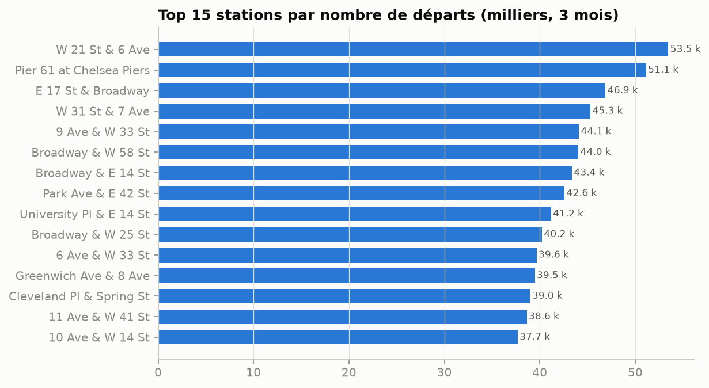

# Résultats (exécution locale sur les données réelles)

Période : **31/07/2026 → 31/10/2026** (93 jours). Généré par `python docs/make_results.py` à partir des tables Gold.

## 1. Volumétrie et qualité des données (notebook 01)

* Trajets bruts : **15 317 456** · valides après contrôles : **15 266 267** (99.67%).
* Réconciliation des identifiants : **99.15 %** des départs/arrivées rattachés à une station GBFS actuelle.
* Grille Gold station × heure : **5 523 091** lignes · 2489 stations actives.

| Contrôle | Lignes | % du brut |
|---|---:|---:|
| valid | 15 266 267 | 99.666 |
| missing_end_station | 42 442 | 0.277 |
| missing_start_station | 8 666 | 0.057 |
| duration_gt_24h | 81 | 0.001 |
| duplicate_ride_id | 0 | 0.000 |
| station_matched (stations) | 2 460 | 99.15 % des trajets |
| station_gbfs_only (stations) | 59 | 0.00 % des trajets |
| station_trips_only (stations) | 109 | 0.85 % des trajets |

## 2. Usage (notebook 02)

* **15 266 267** trajets, soit **164 153** par jour en moyenne ; jour record : 211 757 le 18/09/2026.
* Jours ouvrés : 170 524 trajets/jour · week-end : 148 581 (-12.9%).
* Abonnés : **80.7 %** des trajets ; vélos électriques : **73.0 %** ; durée moyenne 13.1 min.
* Heures de pointe en semaine : **17 h** (17 455 trajets/h) — pic du matin à 8 h (12 791 trajets/h).

## 3. Stations

Sur un mois entier, départs ≈ arrivées presque partout (rééquilibrage par camions, allers-retours) : le déséquilibre est **intrajournalier**. Rôle calculé sur le pic du matin (7h-10h, jours ouvrés) :

| Rôle le matin | Stations |
|---|---:|
| equilibree | 1811 |
| source le matin (se vide) | 417 |
| puits le matin (se remplit) | 261 |

**177** stations perdent en moyenne plus de 30 % de leur capacité chaque matin de semaine (se videraient sans rééquilibrage) et **119** en gagnent plus de 30 % (saturation).

## 4. Effet de la météo

Jours ouvrés 7h-19h : **10 875** trajets/h par temps sec contre **8 349** sous la pluie (**-23%**), sur 90 heures pluvieuses seulement — à confirmer sur une période plus longue.

## 5. Machine Learning (notebook 03)

Découpage chronologique : les 7 derniers jours servent de test. Baseline = moyenne historique de la station pour la même heure et le même type de jour.

| Cible | MAE baseline | MAE modèle | RMSE baseline | RMSE modèle | Erreur réseau/heure (WAPE) baseline → modèle |
|---|---:|---:|---:|---:|---:|
| arrivals | 1.374 | 1.310 | 2.854 | 2.771 | 10.3 % → **7.6 %** |
| departures | 1.337 | 1.298 | 2.802 | 2.750 | 10.2 % → **7.4 %** |

Lecture : au niveau d'une station et d'une heure (≈ 1-2 trajets en moyenne), l'aléa domine et le modèle ne gagne que 3.0 % de MAE. Sommé sur le réseau, où la météo et la tendance saisonnière jouent pleinement, l'erreur horaire baisse nettement.

## 6. Priorités d'intervention (notebook 04, état live GBFS)

Snapshot : **17/11/2026 10:00** (heure de New York), horizon 2 h.

| État | Stations |
|---|---:|
| vide maintenant | 297 |
| risque vide | 399 |
| saturee maintenant | 289 |
| risque saturee | 119 |
| ok | 1366 |

Vélos à déplacer pour ramener les stations à risque à 50 % : **17 009**.

| Rang | Station | Vélos dispo / capacité | Départs prévus | Arrivées prévues | État | Action |
|---:|---|---:|---:|---:|---|---|
| 1 | Broadway & E 14 St | 105 / 114 | 44.0 | 52.6 | saturee maintenant | retirer des velos (-57) |
| 2 | Broadway & W 25 St | 103 / 109 | 39.3 | 42.2 | saturee maintenant | retirer des velos (-52) |
| 3 | Broadway & W 29 St | 91 / 101 | 31.8 | 50.5 | risque saturee | retirer des velos (-51) |
| 4 | Gansevoort St & Hudson St | 114 / 120 | 24.2 | 36.3 | saturee maintenant | retirer des velos (-60) |
| 5 | Lafayette St & Astor Pl | 96 / 105 | 32.2 | 38.3 | risque saturee | retirer des velos (-50) |
| 6 | 10 Ave & W 18 St | 76 / 78 | 28.2 | 46.4 | risque saturee | retirer des velos (-39) |
| 7 | E 17 St & Broadway | 75 / 78 | 49.3 | 42.9 | saturee maintenant | retirer des velos (-30) |
| 8 | W 15 St & 6 Ave | 68 / 75 | 34.9 | 40.3 | risque saturee | retirer des velos (-35) |
| 9 | W 27 St & 7 Ave | 69 / 75 | 27.6 | 42.5 | risque saturee | retirer des velos (-37) |
| 10 | W 59 St & 10 Ave | 7 / 117 | 25.5 | 19.3 | risque vide | ajouter des velos (+57) |

## 7. Agrégations avancées (notebook 05)

* **Rééquilibrage** : en moyenne **1 380** vélos par jour doivent être déplacés par camion (jours ouvrés 1 572, week-end 919) ; **1.6 %** des stations en ont besoin un jour donné. Méthode : somme cumulée heure par heure de (arrivées − départs) depuis minuit ; si l'amplitude de ce stock dépasse la capacité, aucun niveau de remplissage du matin n'évite la rupture.
* Stations demandant le plus souvent un camion : Throop Ave & Myrtle Ave (75 j), 5 Ave & 37 St (72 j), W 50 St & 9 Ave (65 j), Dock 72 Way & Market St (63 j), North Moore St & Greenwich St (62 j).
* **Flux origine → destination** : 171 882 liaisons ≥ 20 trajets ; les 100 premières concentrent 1.1% de ces trajets. Liaison n°1 : 55 Ave & Center Blvd → Vernon Blvd & 50 Ave (3 058 trajets, 3 min médianes).
* **Volatilité** : le décile le plus volatil des stations a un coefficient de variation ≥ 2.11 (demande horaire très irrégulière, plus difficile à prévoir).
* **Tendance hebdomadaire** : de 166 461 à 163 164 trajets/jour entre la 2e et l'avant-dernière semaine complète.

## 8. MLOps : promotion du modèle

| Modèle | Version candidate | MAE candidate | Champion avant | MAE champion | Baseline | Promu |
|---|---:|---:|---:|---:|---:|---|
| smartbike_demand_model_departures | 1 | 1.2976 | None | None | 1.3373 | oui |
| smartbike_demand_model_arrivals | 1 | 1.3097 | None | None | 1.3742 | oui |
