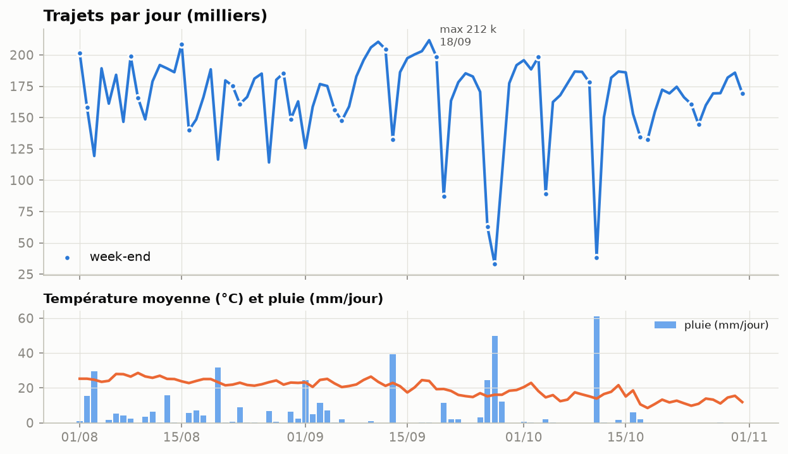
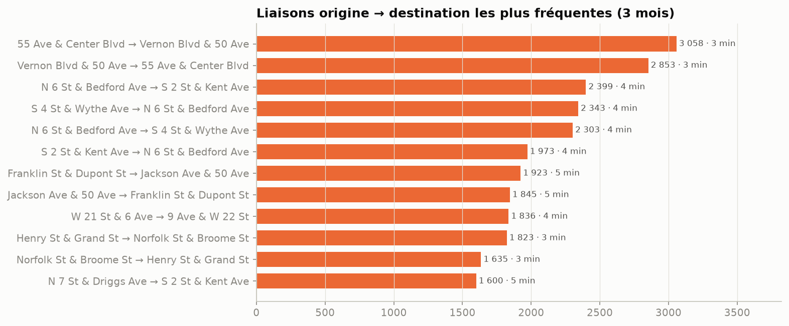

# Résultats (exécution locale sur les données réelles)

Période : **01/08/2026 → 31/10/2026** (92 jours). Généré par `python docs/make_results.py` à partir des tables Gold.

## 1. Volumétrie et qualité des données (notebook 01)

* Trajets bruts : **15 317 456** · valides après contrôles : **15 264 865** (99.66%).
* Réconciliation des identifiants : **99.15 %** des départs/arrivées rattachés à une station GBFS actuelle.
* Grille Gold station × heure : **5 495 712** lignes · 2489 stations actives.

| Contrôle | Lignes | % du brut |
|---|---:|---:|
| valid | 15 264 865 | 99.657 |
| missing_end_station | 42 394 | 0.277 |
| missing_start_station | 8 662 | 0.057 |
| started_outside_loaded_months | 1 454 | 0.009 |
| duration_gt_24h | 81 | 0.001 |
| duplicate_ride_id | 0 | 0.000 |
| station_matched (stations) | 2 460 | 99.15 % des trajets |
| station_gbfs_only (stations) | 59 | 0.00 % des trajets |
| station_trips_only (stations) | 109 | 0.85 % des trajets |

## 2. Usage (notebook 02)

* **15 264 865** trajets, soit **165 922** par jour en moyenne ; jour record : 211 757 le 18/09/2026.
* Jours ouvrés : 173 126 trajets/jour · week-end : 148 581 (-14.2%).
* Abonnés : **80.7 %** des trajets ; vélos électriques : **73.0 %** ; durée moyenne 13.1 min.
* Heures de pointe en semaine : **17 h** (17 700 trajets/h) — pic du matin à 8 h (12 948 trajets/h).

## 3. Stations

Sur un mois entier, départs ≈ arrivées presque partout (rééquilibrage par camions, allers-retours) : le déséquilibre est **intrajournalier**. Rôle calculé sur le pic du matin (7h-10h, jours ouvrés) :

| Rôle le matin | Stations |
|---|---:|
| equilibree | 1803 |
| source le matin (se vide) | 422 |
| puits le matin (se remplit) | 264 |

**179** stations perdent en moyenne plus de 30 % de leur capacité chaque matin de semaine (se videraient sans rééquilibrage) et **124** en gagnent plus de 30 % (saturation).

## 4. Effet de la météo

Jours ouvrés 7h-19h : **10 875** trajets/h par temps sec contre **9 053** sous la pluie (**-17%**), sur 83 heures pluvieuses seulement — à confirmer sur une période plus longue.

## 5. Machine Learning (notebook 03)

Découpage chronologique : les 7 derniers jours servent de test. Baseline = moyenne historique de la station pour la même heure et le même type de jour.

| Cible | MAE baseline | MAE modèle | RMSE baseline | RMSE modèle | Erreur réseau/heure (WAPE) baseline → modèle |
|---|---:|---:|---:|---:|---:|
| arrivals | 1.376 | 1.312 | 2.853 | 2.779 | 10.3 % → **7.6 %** |
| departures | 1.339 | 1.296 | 2.801 | 2.743 | 10.3 % → **7.3 %** |

Lecture : au niveau d'une station et d'une heure (≈ 1-2 trajets en moyenne), l'aléa domine et le modèle ne gagne que 3.2 % de MAE. Sommé sur le réseau, où la météo et la tendance saisonnière jouent pleinement, l'erreur horaire baisse nettement.

## 6. Priorités d'intervention (notebook 04, état live GBFS)

Snapshot : **17/11/2026 11:00** (heure de New York), horizon 2 h.

| État | Stations |
|---|---:|
| vide maintenant | 319 |
| risque vide | 367 |
| saturee maintenant | 242 |
| risque saturee | 130 |
| ok | 1412 |

Vélos à déplacer pour ramener les stations à risque à 50 % : **16 142**.

| Rang | Station | Vélos dispo / capacité | Départs prévus | Arrivées prévues | État | Action |
|---:|---|---:|---:|---:|---|---|
| 1 | Broadway & W 25 St | 101 / 109 | 43.1 | 48.4 | saturee maintenant | retirer des velos (-52) |
| 2 | Broadway & E 14 St | 101 / 114 | 43.5 | 48.0 | risque saturee | retirer des velos (-49) |
| 3 | Broadway & W 29 St | 90 / 101 | 35.7 | 41.7 | risque saturee | retirer des velos (-46) |
| 4 | Gansevoort St & Hudson St | 110 / 120 | 24.0 | 32.0 | saturee maintenant | retirer des velos (-58) |
| 5 | E 40 St & 5 Ave | 90 / 93 | 31.9 | 33.5 | risque saturee | retirer des velos (-46) |
| 6 | Lafayette St & Astor Pl | 95 / 105 | 33.2 | 33.6 | risque saturee | retirer des velos (-43) |
| 7 | W 43 St & 10 Ave | 1 / 117 | 23.7 | 22.5 | risque vide | ajouter des velos (+58) |
| 8 | 10 Ave & W 18 St | 74 / 78 | 27.0 | 39.2 | saturee maintenant | retirer des velos (-39) |
| 9 | Central Park S & Grand Army Plaza | 80 / 85 | 40.3 | 35.8 | saturee maintenant | retirer des velos (-34) |
| 10 | 10 Ave & W 14 St | 79 / 81 | 28.9 | 32.3 | saturee maintenant | retirer des velos (-41) |

## 7. Agrégations avancées (notebook 05)

* **Rééquilibrage** : en moyenne **1 380** vélos par jour doivent être déplacés par camion (jours ouvrés 1 572, week-end 919) ; **1.6 %** des stations en ont besoin un jour donné. Méthode : somme cumulée heure par heure de (arrivées − départs) depuis minuit ; si l'amplitude de ce stock dépasse la capacité, aucun niveau de remplissage du matin n'évite la rupture.
* Stations demandant le plus souvent un camion : Throop Ave & Myrtle Ave (75 j), 5 Ave & 37 St (72 j), W 50 St & 9 Ave (65 j), Dock 72 Way & Market St (63 j), North Moore St & Greenwich St (62 j).
* **Flux origine → destination** : 171 864 liaisons ≥ 20 trajets ; les 100 premières concentrent 1.1% de ces trajets. Liaison n°1 : 55 Ave & Center Blvd → Vernon Blvd & 50 Ave (3 058 trajets, 3 min médianes).
* **Volatilité** : le décile le plus volatil des stations a un coefficient de variation ≥ 2.11 (demande horaire très irrégulière, plus difficile à prévoir).
* **Tendance hebdomadaire** : de 166 461 à 163 164 trajets/jour entre la 2e et l'avant-dernière semaine complète.

## 8. MLOps : promotion du modèle

| Modèle | Version candidate | MAE candidate | Champion avant | MAE champion | Baseline | Promu |
|---|---:|---:|---:|---:|---:|---|
| smartbike_demand_model_departures | 2 | 1.2956 | 1 | 1.2976 | 1.3388 | oui |
| smartbike_demand_model_arrivals | 2 | 1.3119 | 1 | 1.3097 | 1.3755 | non |
