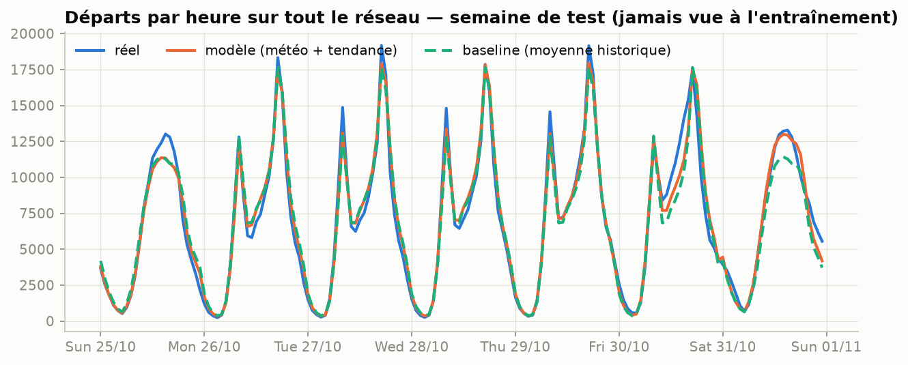
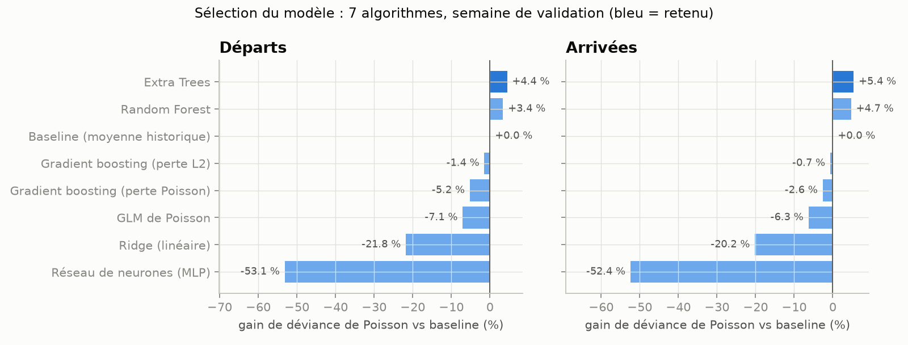
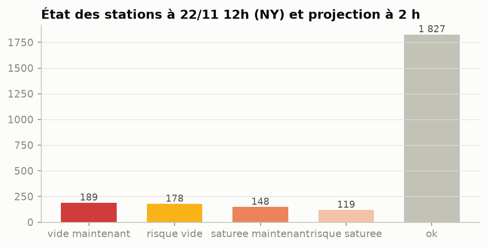
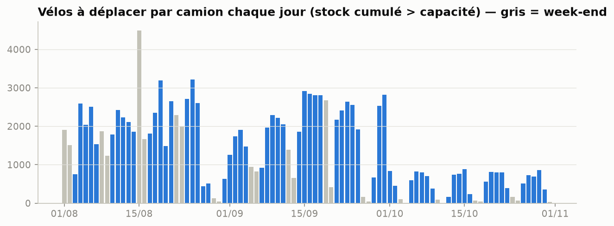
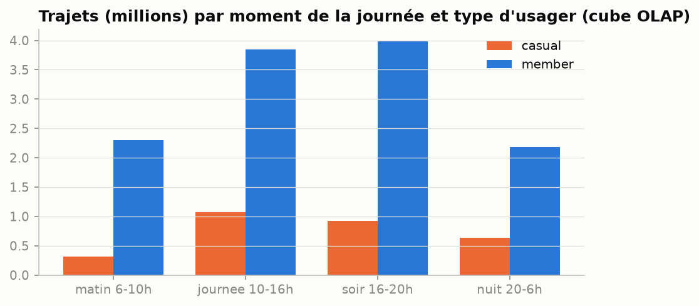
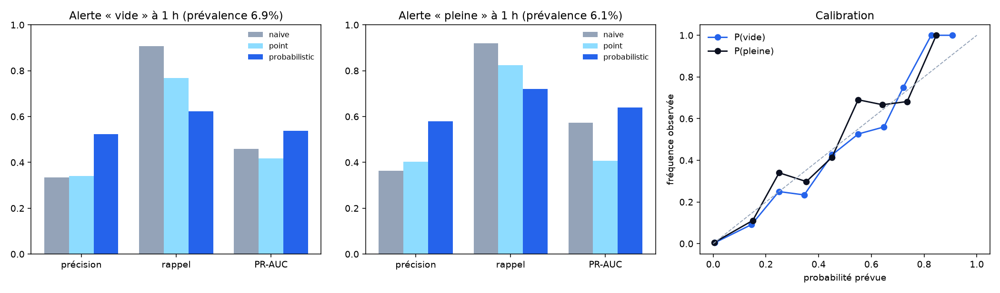

# Résultats (exécution locale sur les données réelles)

Période : **01/08/2026 → 31/10/2026** (92 jours). Généré par `python docs/make_results.py` à partir des tables Gold.

## 1. Volumétrie et qualité des données (notebook 01)

* Trajets bruts : **15 317 456** · valides après contrôles : **15 264 865** (99.66%).
* Réconciliation des identifiants : **99.15 %** des départs/arrivées rattachés à une station GBFS actuelle.
* Grille Gold station × heure : **5 495 712** lignes · 2489 stations actives.

| Contrôle | Lignes | % du brut |
|---|---:|---:|
| valid | 15 264 865 | 99.657 |
| missing_end_station | 42 394 | 0.277 |
| missing_start_station | 8 662 | 0.057 |
| started_outside_loaded_months | 1 454 | 0.009 |
| duration_gt_24h | 81 | 0.001 |
| duplicate_ride_id | 0 | 0.000 |
| station_matched (stations) | 2 460 | 99.15 % des trajets |
| station_gbfs_only (stations) | 59 | 0.00 % des trajets |
| station_trips_only (stations) | 109 | 0.85 % des trajets |

## 2. Usage (notebook 02)

* **15 264 865** trajets, soit **165 922** par jour en moyenne ; jour record : 211 757 le 18/09/2026.
* Jours ouvrés : 173 126 trajets/jour · week-end : 148 581 (-14.2%).
* Abonnés : **80.7 %** des trajets ; vélos électriques : **73.0 %** ; durée moyenne 13.1 min.
* Heures de pointe en semaine : **17 h** (17 700 trajets/h) — pic du matin à 8 h (12 948 trajets/h).

## 3. Stations

Sur un mois entier, départs ≈ arrivées presque partout (rééquilibrage par camions, allers-retours) : le déséquilibre est **intrajournalier**. Rôle calculé sur le pic du matin (7h-10h, jours ouvrés) :

| Rôle le matin | Stations |
|---|---:|
| equilibree | 1803 |
| source le matin (se vide) | 422 |
| puits le matin (se remplit) | 264 |

**179** stations perdent en moyenne plus de 30 % de leur capacité chaque matin de semaine (se videraient sans rééquilibrage) et **124** en gagnent plus de 30 % (saturation).

## 4. Effet de la météo

Jours ouvrés 7h-19h : **10 875** trajets/h par temps sec contre **9 053** sous la pluie (**-17%**), sur 83 heures pluvieuses seulement — à confirmer sur une période plus longue.

## 5. Machine Learning (notebook 03)

Découpage chronologique : les 7 derniers jours servent de test. Baseline = moyenne historique de la station pour la même heure et le même type de jour.

| Cible | MAE baseline | MAE modèle | RMSE baseline | RMSE modèle | Erreur réseau/heure (WAPE) baseline → modèle |
|---|---:|---:|---:|---:|---:|
| arrivals | 1.376 | 1.338 | 2.853 | 2.795 | 10.3 % → **8.0 %** |
| departures | 1.339 | 1.315 | 2.801 | 2.773 | 10.3 % → **8.1 %** |

Lecture : au niveau d'une station et d'une heure (≈ 1-2 trajets en moyenne), l'aléa domine et le modèle ne gagne que 1.8 % de MAE. Sommé sur le réseau, où la météo et la tendance saisonnière jouent pleinement, l'erreur horaire baisse nettement.

### 5.1 Sélection du modèle : 7 algorithmes comparés

Protocole : la dernière semaine de la période d'entraînement sert de **validation** (encodages recalculés sur les semaines précédentes). Chaque algorithme est entraîné sur le même échantillon d'1 million de lignes et jugé sur toute la semaine de validation ; la semaine de **test** ne sert qu'une fois, au modèle retenu. Critère : **déviance de Poisson** (qualité du *taux* prévu, ce que consomme la simulation du risque) ; parmi les modèles à moins de 1 % du meilleur, le plus léger.

**Départs**

| Rang | Modèle | Famille | Déviance | MAE | RMSE | Entraînement | Taille |
|---:|---|---|---:|---:|---:|---:|---:|
| 1 | **Extra Trees** ✓ | arbres extrêmement aléatoires | 1.2294 | 1.2006 | 2.332 | 38 s | 27 Mo |
| 2 | Random Forest | forêt aléatoire (bagging) | 1.2430 | 1.1878 | 2.307 | 71 s | 32 Mo |
| 3 | Baseline (moyenne historique) | moyenne historique station × heure | 1.2865 | 1.2207 | 2.344 | 0 s | 0 Mo |
| 4 | Gradient boosting (perte L2) | gradient boosting, perte quadratique | 1.3050 | 1.1881 | 2.339 | 20 s | 3 Mo |
| 5 | Gradient boosting (perte Poisson) | gradient boosting, perte de Poisson | 1.3536 | 1.1917 | 2.369 | 28 s | 3 Mo |
| 6 | GLM de Poisson | linéaire généralisé, lien log | 1.3773 | 1.3016 | 2.542 | 17 s | 0 Mo |
| 7 | Ridge (linéaire) | linéaire (moindres carrés L2) | 1.5667 | 1.2100 | 2.340 | 4 s | 0 Mo |
| 8 | Réseau de neurones (MLP) | réseau de neurones 64-32 | 1.9702 | 1.2260 | 2.361 | 276 s | 0 Mo |

**Arrivées**

| Rang | Modèle | Famille | Déviance | MAE | RMSE | Entraînement | Taille |
|---:|---|---|---:|---:|---:|---:|---:|
| 1 | **Extra Trees** ✓ | arbres extrêmement aléatoires | 1.2797 | 1.2248 | 2.337 | 36 s | 28 Mo |
| 2 | Random Forest | forêt aléatoire (bagging) | 1.2887 | 1.2093 | 2.316 | 89 s | 33 Mo |
| 3 | Baseline (moyenne historique) | moyenne historique station × heure | 1.3528 | 1.2559 | 2.385 | 0 s | 0 Mo |
| 4 | Gradient boosting (perte L2) | gradient boosting, perte quadratique | 1.3618 | 1.2054 | 2.356 | 21 s | 3 Mo |
| 5 | Gradient boosting (perte Poisson) | gradient boosting, perte de Poisson | 1.3881 | 1.2058 | 2.401 | 31 s | 3 Mo |
| 6 | GLM de Poisson | linéaire généralisé, lien log | 1.4381 | 1.3345 | 2.546 | 14 s | 0 Mo |
| 7 | Ridge (linéaire) | linéaire (moindres carrés L2) | 1.6257 | 1.2418 | 2.382 | 3 s | 0 Mo |
| 8 | Réseau de neurones (MLP) | réseau de neurones 64-32 | 2.0619 | 1.2727 | 2.416 | 152 s | 0 Mo |

## 6. Priorités d'intervention (notebook 04, état live GBFS)

Snapshot : **22/11/2026 12:00** (heure de New York), horizon 2 h.

| État | Stations |
|---|---:|
| vide maintenant | 189 |
| risque vide | 178 |
| saturee maintenant | 148 |
| risque saturee | 119 |
| ok | 1827 |

Vélos à déplacer pour ramener les stations à risque à 50 % : **7 965**.

| Rang | Station | Vélos dispo / capacité | Départs prévus | Arrivées prévues | État | Action |
|---:|---|---:|---:|---:|---|---|
| 1 | 10 Ave & W 14 St | 74 / 81 | 43.5 | 47.1 | saturee maintenant | retirer des velos (-37) |
| 2 | 12 Ave & W 40 St | 1 / 76 | 51.5 | 40.5 | risque vide | ajouter des velos (+35) |
| 3 | Cooper Square & Astor Pl | 80 / 87 | 32.1 | 32.7 | risque saturee | retirer des velos (-41) |
| 4 | W 31 St & 7 Ave | 79 / 84 | 27.3 | 26.1 | saturee maintenant | retirer des velos (-38) |
| 5 | W Broadway & Spring St | 94 / 99 | 18.6 | 22.5 | saturee maintenant | retirer des velos (-47) |
| 6 | 9 Ave & W 18 St | 82 / 84 | 22.1 | 21.8 | saturee maintenant | retirer des velos (-41) |
| 7 | W 4 St & 7 Ave S | 42 / 60 | 45.4 | 56.9 | risque saturee | retirer des velos (-27) |
| 8 | Bleecker St & Crosby St | 61 / 63 | 31.5 | 29.3 | saturee maintenant | retirer des velos (-29) |
| 9 | Lafayette St & Jersey St | 56 / 60 | 29.7 | 31.6 | saturee maintenant | retirer des velos (-28) |
| 10 | Metropolitan Ave & Bedford Ave | 52 / 54 | 38.5 | 39.0 | risque saturee | retirer des velos (-27) |

## 7. Agrégations avancées (notebook 05)

* **Rééquilibrage** : en moyenne **1 380** vélos par jour doivent être déplacés par camion (jours ouvrés 1 572, week-end 919) ; **1.6 %** des stations en ont besoin un jour donné. Méthode : somme cumulée heure par heure de (arrivées − départs) depuis minuit ; si l'amplitude de ce stock dépasse la capacité, aucun niveau de remplissage du matin n'évite la rupture.
* Stations demandant le plus souvent un camion : Throop Ave & Myrtle Ave (75 j), 5 Ave & 37 St (72 j), W 50 St & 9 Ave (65 j), Dock 72 Way & Market St (63 j), North Moore St & Greenwich St (62 j).
* **Flux origine → destination** : 171 864 liaisons ≥ 20 trajets ; les 100 premières concentrent 1.1% de ces trajets. Liaison n°1 : 55 Ave & Center Blvd → Vernon Blvd & 50 Ave (3 058 trajets, 3 min médianes).
* **Volatilité** : le décile le plus volatil des stations a un coefficient de variation ≥ 2.11 (demande horaire très irrégulière, plus difficile à prévoir).
* **Tendance hebdomadaire** : de 166 461 à 163 164 trajets/jour entre la 2e et l'avant-dernière semaine complète.

## 8. MLOps : promotion du modèle

Le candidat et le champion en place sont ré-évalués sur la **même** semaine de test, avec le critère de la sélection (déviance de Poisson) ; le candidat doit aussi battre la baseline (déviance et MAE).

| Modèle | Candidat | Déviance candidat | Champion avant | Déviance champion | Déviance baseline | MAE candidat / champion | Promu |
|---|---|---:|---|---:|---:|---:|---|
| smartbike_demand_model_departures | v5 Extra Trees | 1.4271 | v2 Gradient boosting (perte Poisson) | 1.5030 | 1.4988 | 1.3148 / 1.2956 | **oui** |
| smartbike_demand_model_arrivals | v5 Extra Trees | 1.4836 | v1 Gradient boosting (perte Poisson) | 1.5303 | 1.5720 | 1.3379 / 1.3124 | **oui** |

## 9. Tournées des camions de rééquilibrage (OR-Tools)

Flotte : 3 camions de 30 vélos, tournée de 240 min, 80 stations candidates (les plus prioritaires), camions partis vides, 15 km/h, 4 min par arrêt + 15 s par vélo. Problème : collecte et livraison avec capacité et prix (une station non visitée « coûte » sa priorité), résolu par OR-Tools (recherche locale guidée, 15 s), comparé à la pratique « suivre la liste de priorité dans l'ordre ».

| Méthode | Arrêts | Vélos déplacés | Urgence couverte | Distance | Vélos / km |
|---|---:|---:|---:|---:|---:|
| greedy (liste de priorité) | 25 | 637 | 40% | 106 km | 6.0 |
| optimisé (OR-Tools) | 33 | 839 | 53% | 93 km | 9.0 |

Sur ce relevé, l'optimisation déplace **+32% de vélos** et couvre **53%** de l'urgence (contre 40%) en roulant 93 km au lieu de 106 km. Le gain vient de l'ordre des arrêts : enchaîner une station pleine puis une station vide voisine, au lieu de traverser la ville au rythme du classement.

## 10. Fiabilité des alertes : backtest sur l'historique réel

Vérité terrain : flux GBFS enregistré toutes les 5 min (`scripts/gbfs_history.py`). À chaque instant de départ, l'alerte est recalculée comme en production (état des stations, météo, modèles champion), puis comparée à ce qui s'est réellement passé dans les **1 h** suivantes. Stations déjà en rupture exclues ; seuil de probabilité réglé sur la première moitié des instants, évalué sur la seconde. Instants de test : 1 ; fenêtres station × horizon évaluées : 2 246.

| Alerte | Méthode | Alertes | Ruptures réelles | Précision | Rappel | F1 | PR-AUC |
|---|---|---:|---:|---:|---:|---:|---:|
| vide | stock déjà bas (sans prévision) | 411 | 151 | 33% | 91% | 0.49 | 0.46 |
| vide | prévision ponctuelle (ancienne règle) | 340 | 151 | 34% | 77% | 0.47 | 0.42 |
| vide | probabiliste (Monte Carlo) | 180 | 151 | 52% | 62% | 0.57 | 0.54 |
| pleine | stock déjà bas (sans prévision) | 344 | 136 | 36% | 92% | 0.52 | 0.57 |
| pleine | prévision ponctuelle (ancienne règle) | 278 | 136 | 40% | 82% | 0.54 | 0.41 |
| pleine | probabiliste (Monte Carlo) | 169 | 136 | 58% | 72% | 0.64 | 0.64 |

Lecture : la précision dit si l'opérateur peut faire confiance à une alerte, le rappel combien de ruptures réelles ont été vues à temps ; la PR-AUC mesure la qualité du classement des stations (hasard = prévalence, ici 6.9%).

> Historique encore court au moment de la génération : ces chiffres sont à reconfirmer en relançant `scripts/backtest_alerts.py` après plusieurs jours d'enregistrement (le script, les tables et ce rapport se mettent à jour automatiquement).
